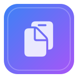

MaClip
================

<p align="center">
  
</p>

A simple macOS clipboard history app built with SwiftUI.

## Install

1. Download `MacClip-<version>.dmg` from the [latest release](https://github.com/jokot/mac-clipboard/releases/latest).
2. Open the DMG and drag **MaClip** to **Applications**.
3. Open MaClip. macOS shows "“MaClip.app” Not Opened", because the app is not notarized by Apple. Click **Done**.
4. Open **System Settings → Privacy & Security**. Scroll down to "MaClip.app was blocked" and click **Open Anyway**. Confirm with your password.

You do this one time for each install. Or, run this command in Terminal instead of steps 3 and 4:

```bash
xattr -dr com.apple.quarantine /Applications/MaClip.app
```

MaClip asks for Accessibility access the first time that it pastes a clip for you. It needs this access to press ⌘V in the app that you used before. Without it, MaClip copies the clip, and you press ⌘V. To check the access, open Settings → Behavior.

See [CHANGELOG.md](CHANGELOG.md) for the changes in each version.

## Preview


https://github.com/user-attachments/assets/55cb6c86-be5d-4175-98f1-ddbddc5ded3d

## Features
- Keeps a history of copied text, links, images, and files.
- Opens with <kbd>⌃</kbd> <kbd>⌘</kbd> <kbd>V</kbd> or from the menu bar icon. You can change the shortcut in Settings.
- Search the history. Filter with `from:Safari` or `tag:code`.
- Edit text, link, and file clips. Edit image clips: crop, rotate, arrow, shapes, text, pen, and redact.
- Extract text (OCR) and barcodes or QR codes from images.
- Paste the text or the QR code from your last screenshot in any app: <kbd>⌃</kbd> <kbd>⌥</kbd> <kbd>⌘</kbd> <kbd>T</kbd> for text, <kbd>⌃</kbd> <kbd>⌥</kbd> <kbd>⌘</kbd> <kbd>B</kbd> for a QR code or barcode. You can change the shortcuts in Settings → General.
- Skip apps that you choose, such as password managers. Hide and auto-clear concealed items.
- Optional: encrypt the history on disk (Settings → Storage). This feature uses a key in your login Keychain.

## Usage
1. Press <kbd>⌃</kbd> <kbd>⌘</kbd> <kbd>V</kbd> to open MaClip.
2. Type to search. Use <kbd>↑</kbd> and <kbd>↓</kbd> to move.
3. Press <kbd>Return</kbd> or click a clip to paste it. Press <kbd>Esc</kbd> to close.
4. Right-click a clip to edit it or to exclude its app.
5. Press <kbd>⌘</kbd> <kbd>,</kbd> to open Settings.

## Build from source
Requires Xcode and Homebrew.

```bash
brew install xcodegen
xcodegen generate
open MacClipboard.xcodeproj
```

Run the tests with `xcodebuild -scheme MacClipboard -destination 'platform=macOS' test`. To build the release DMG, run `scripts/release/build-dmg.sh <version>`.

## Contributing
See [CONTRIBUTING.md](CONTRIBUTING.md). It also explains how releases work.

## License
MIT License. See `LICENSE` for details.
